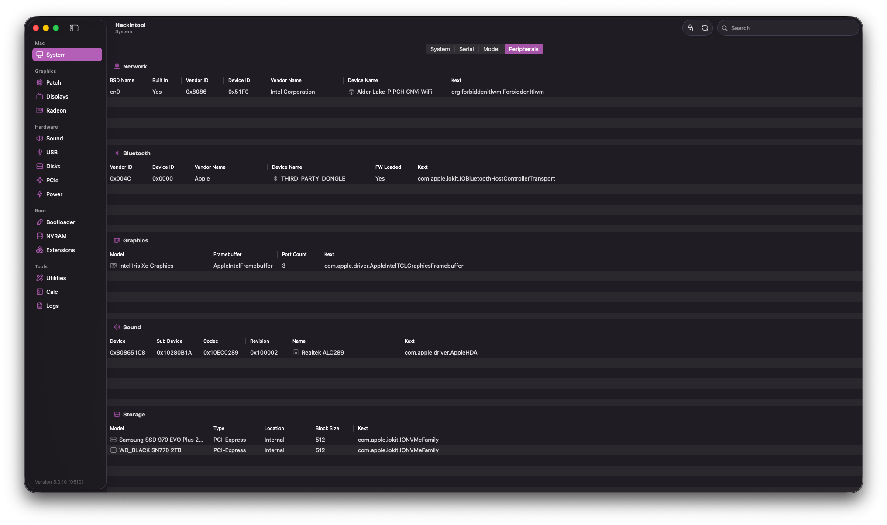

# Dell Precision 5570 — Complete macOS OpenCore Guide & EFI

An actively maintained OpenCore 1.0.8 EFI guide for running macOS Tahoe 26.7.2 on a Dell Precision 5570 with an Intel i7-12800H and Iris X<sup>e</sup> graphics.

---

## Screenshots & System Verification

| System Overview & Specs | Iris X<sup>e</sup> Metal 2 Graphics Acceleration (with the A1000) |
| :---: | :---: |
|  |  |

| Peripherals & Storage | Full PCIe Device Tree |
| :---: | :---: |
|  |  |

---

## Hardware Specifications & Compatibility

| Component | Hardware Details | Status | Notes |
| :--- | :--- | :---: | :--- |
| **Model** | Dell Precision 5570 | `Supported` ||
| **Processor** | Intel Core i7-12800H | `Working` | Native BIOS 10-thread topology + `CpuTscSync` (`TSC_sync_margin=0 -cputsclock`); `CpuTopologyRebuild` disabled |
| **Integrated GPU** | Intel Iris X<sup>e</sup> Graphics GT2 (`8086:46A8`) | `Working` | 1536 MB VRAM, Metal 2, Full QE/CI via `WhateverXe v0.7.0` |
| **Dedicated GPU**  | NVIDIA RTX A1000 GPU (4 GB VRAM) | `Not tested` | Using nullmoth’s [nvidia-macos-driver](https://github.com/nullmoth/nvidia-macos-driver), it shows up and shows Metal 2 acceleration, however this model has no way to route any of its display outputs to it. |
| **RAM** | 16 GB DDR5 4800 MHz (8 GB SODIMMs) | `Working` | Dual-Channel |
| **Storage** | 2 TB Samsung 970 EVO Plus NVMe SSD / 2 TB WD_BLACK SN770 NVMe SSD | `Working` | Managed via `NVMeFix.kext v1.1.4` |
| **Display** | 15″ Full HD (1920x1200) 60Hz eDP Panel | `Working` | Native brightness slider |
| **External Displays** | Through the Thunderbolt 4 ports or USB-C port with DP Alt Mode | `Not working` | [^2]
| **Trackpad** | Precision Touchpad  | `Working` | Smooth cursor, clicks & gestures via `VoodooI2C v2.9.1` + `VoodooI2CHID` (`-vi2c-force-polling`) |
| **Keyboard** | PS/2 Keyboard | `Working` | `VoodooPS2Controller v2.3.8` |
| **Audio (Internal)** | Realtek ALC289 | `Somewhat working` | Sound from the internal speakers only outputs through the tweeters, not the subwoofers. With `alcid=33`, the sound outputs exclusively through the woofers.  |
| **Bluetooth** | Intel AX211 | `Working` | Scanning, pairing, mic input & A2DP audio with [BlueToolFixup](https://github.com/acidanthera/BrcmPatchRAM/), [IntelBTPatcher](https://github.com/OpenIntelWireless/IntelBluetoothFirmware/), & [IntelBluetoothFirmware](https://github.com/OpenIntelWireless/IntelBluetoothFirmware/) |
| **Wi-Fi** | Intel AX211 | `Iffy` | Can connect with [forbiddenitlwm](https://github.com/VedCloud/forbiddenitlwm). |
| **Webcam** | Sonix webcam | `Working` | Native plug-and-play |
| **USB Ports** | Two Thunderbolt 4 ports on the left side of the laptop and a USB 3.2 Gen 2 port with DisplayPort Alt Mode on the right side | `Working` | USB works, and devices connected over Thunderbolt *may* work[^1]. |
| **Battery / Power** | | `Working` | Accurate readout & AC state via `SMCBatteryManager` |

[^1]: I do not have any other Thunderbolt devices except for the dock for me to test; however if I booted with the dock plugged in, a icon in the menu bar showed up with the option to turn off what it thinks are PCMCIA cards.
[^2]: When plugged into a Dell Thunderbolt 4 dock (`SD25TB4`), it does not output to a display. You *can* get an unaccelerated output, provided that you start macOS with the lid closed.wha

---

## Post-Installation: Intel Iris X<sup>e</sup> Acceleration Restorer

After installing macOS (or if macOS ever starts up non-accelerated), run the automated script to install/rebuild `WhateverXe-Graphics-0.4.0` into `AuxiliaryKernelExtensions.kc`:

```bash
sudo ./Utilities/postinstall.sh
```
(*Or double-click [`Utilities/Restore_1536MB_Acceleration.command`](Utilities/Restore_1536MB_Acceleration.command) in the Finder.*)

### What `activate_acceleration.sh` Automates
1. Purges any conflicting `/Library/Extensions` audio kexts (`HDAUniversal.kext`, `VoodooHDA.kext`, `AppleHDADisabler.kext`).
2. Clears macOS extension staging (`kmutil clear-staging`).
3. Locates or downloads `WhateverXe-Graphics-0.4.0.pkg` and validates `/Library/Extensions/AppleIntelTGL*` + `/Library/GPUBundles`.
4. Enforces `root:wheel` `755` permissions, clears quarantine attributes (`xattr -cr`), and disables `AllowOnePassMetalScaling` in `CoreMedia.plist`.
5. Builds `/Library/KernelCollections/AuxiliaryKernelExtensions.kc` via `kmutil create -n aux --allow-missing-kdk --no-authentication`.

> [!CAUTION]
> ### Ignore System Settings!
> When `activate_acceleration.sh` completes, macOS may show “System Extension Blocked.”
>
> 1. **DO NOT open System Settings → Privacy & Security!**
> 2. **DO NOT click “Allow” or “Restart” inside System Settings!**
>
> Clicking Restart inside System Settings runs macOS’ `kmutil rebuild` **without** `--allow-missing-kdk`, wiping your Iris X<sup>e</sup> drivers back to 7 MB VESA mode.
>
> **Safe Reboot:** Press <kbd>Enter</kbd> directly in the Terminal script prompt → press **<kbd>Spacebar</kbd> → Reset NVRAM** once at the OpenCore picker → boot macOS normally.

---

## Installation & Setup Guide

### 1. BIOS Settings (<kbd>F2</kbd>)
* **Disable** Secure Boot (this may mess up Windows Hello if you are dual booting)

### 2. Generate Unique SMBIOS Before Booting (`MacBookPro16,2`)
> [!IMPORTANT]
> The [`EFI/OC/config.plist`](EFI/OC/config.plist) in this repository contains sanitized placeholder serial numbers (`C02000000000`). Generate your own unique SMBIOS values before signing into Apple ID / iCloud!

Use **[GenSMBIOS](https://github.com/corpnewt/GenSMBIOS)** for **`MacBookPro16,2`** (see “[Generating an SMBIOS](../../wiki/Generating-an-SMBIOS)”) and update `PlatformInfo -> Generic` (`SystemSerialNumber`, `MLB`, `SystemUUID`, `ROM`) in ProperTree.

### 3. Deploy to USB & Boot
1. Copy the [`EFI/`](EFI/) folder from this repository to the root of your FAT32 EFI partition (test on a USB drive first before touching your internal SSD!).
2. **Do not delete or overwrite `EFI/Microsoft` on your internal NVMe SSD** when dual-booting Windows.
3. Boot via <kbd>F12</kbd> → select USB → press **<kbd>Spacebar</kbd> → Reset NVRAM** on first boot → boot macOS.

---

## Post-Installation Utilities

Bundled in [`Utilities/`](Utilities/) (all Unix LF line endings):
* [`postinstall.sh`](Utilities/postinstall.sh) & [`Restore_1536MB_Acceleration.command`](Utilities/Restore_1536MB_Acceleration.command) — Installs/restores 1536 MB Iris X<sup>e</sup> Metal 2 `AuxKC` cleanly.
* [`optimize_power.sh`](Utilities/optimize_power.sh) — Configures `pmset` (disables hibernation/sleepimage to keep USB peripherals stable).

---

## Repository Structure

```text
precisiontosh-5570/
├── EFI/
│   ├── BOOT/
│   │   └── BOOTx64.efi
│   └── OC/
│       ├── ACPI/
│       │   ├── SSDT-EC.aml / .dsl
│       │   ├── SSDT-PLUG-ALT.aml / .dsl
│       │   ├── SSDT-PNLF.aml / .dsl
│       │   ├── SSDT-RTCAWAC.aml / .dsl
│       │   ├── SSDT-SBUS-MCHC.aml / .dsl
│       │   ├── SSDT-USBX.aml / .dsl
│       │   └── SSDT-XOSI.aml / .dsl
│       ├── Drivers/
│       │   ├── HfsPlus.efi
│       │   ├── OpenCanopy.efi
│       │   ├── OpenRuntime.efi
│       │   └── ResetNvramEntry.efi
│       ├── Kexts/
│       │   ├── AMFIPass.kext
│       │   ├── AppleALC.kext
│       │   ├── BlueToolFixup.kext
│       │   ├── BrightnessKeys.kext
│       │   ├── CpuTopologyRebuild.kext
│       │   ├── CpuTscSync.kext
│       │   ├── ForbiddenItlwm.kext
│       │   ├── IntelBTPatcher.kext
│       │   ├── IntelBluetoothFirmware.kext
│       │   ├── Lilu.kext
│       │   ├── NVMeFix.kext
│       │   ├── NullEthernet.kext
│       │   ├── RestrictEvents.kext
│       │   ├── SMCBatteryManager.kext
│       │   ├── SMCLightSensor.kext
│       │   ├── SMCProcessor.kext
│       │   ├── SimpleHDA.kext
│       │   ├── USBToolBox.kext
│       │   ├── UTBDefault.kext
│       │   ├── UTBMap.kext
│       │   ├── VirtualSMC.kext
│       │   ├── VoodooI2C.kext
│       │   ├── VoodooI2CHID.kext
│       │   ├── VoodooPS2Controller.kext
│       │   ├── WhateverXe.kext
│       │   └── XHCI-unsupported.kext
│       ├── Resources/
│       ├── OpenCore.efi
│       └── config.plist
├── Screenshots/
│   ├── 01_System_Overview.png
│   ├── 02_GPU_Metal_Acceleration.png
│   ├── 03_Peripherals_Overview.png
│   └── 04_PCIe_Devices.png
├── Utilities/
│   ├── activate_acceleration.sh # run this after setup!
│   ├── Restore_1536MB_Acceleration.command
│   ├── fix_tethering.sh
│   ├── optimize_power.sh
│   └── generate_smbios.md # run this before booting into recovery!
└── README.md
```

---

## Credits & Acknowledgements

* ### **[jigyanshu-codes](https://github.com/jigyanshu-codes/)** – The original EFI
* **[Acidanthera](https://github.com/acidanthera)** — OpenCorePkg, Lilu, VirtualSMC, AppleALC, BrcmPatchRAM (`BlueToolFixup`), NVMeFix, RestrictEvents, VoodooPS2, BrightnessKeys
* **[WhateverXe Team (`b00t0x`)](https://github.com/b00t0x/WhateverXe)** — Pioneering Intel Iris X<sup>e</sup> graphics acceleration on macOS
* **[laobamac](https://github.com/laobamac)** — `SimpleHDA` (`cn.laobamac.SimpleHDA`)
* **[Alexandred](https://github.com/alexandred)** & **[CoolStar](https://github.com/coolstar)** — `VoodooI2C` & `VoodooGPIO`
* **[DhinakG / USBToolBox](https://github.com/USBToolBox)** — `USBToolBox` & custom port mapping
* **[Dortania](https://dortania.github.io/)** — OpenCore Install & ACPI Guides
* **[Belugaa_01](https://www.reddit.com/user/Belugaa_01/)** — Initial Alder Lake-U WhateverXe offset discovery

---

Please feel free to leave a star if you found this helpful.
